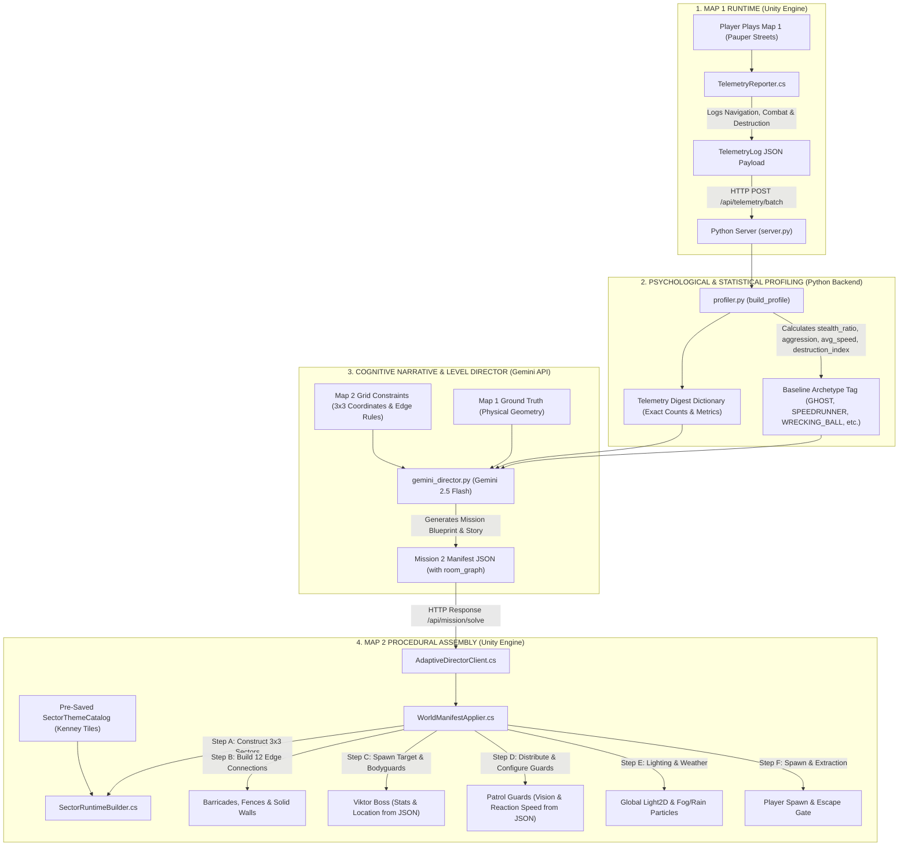

# AdaptiveWorld2D — End-to-End System Architecture Chain

This document details the complete, unbroken chain of the **AdaptiveWorld2D** dynamic world generation pipeline — from the moment the player touches a key in Map 1 to the procedural assembly of Map 2 in Unity.

---

## The Complete Architecture Chain (Visual Summary)



---

## Link 1: What Data is Collected from Map 1?

During Map 1 (*Pauper Streets*), the game engine silently observes the player without interfering with gameplay. In Unity, [`TelemetryReporter.cs`](file:///c:/Users/xDDDDD/AdaptiveWorld2D/Assets/Scripts/Telemetry/TelemetryReporter.cs) continuously logs three distinct event streams:

### A. Navigation Events (`NavigationEvent`)
* **Movement Type**: `WALK`, `SPRINT`, or `DRIVE` (entering/exiting cars).
* **Surface Type**: `ROAD` (wide open street), `ALLEY` (narrow back alleys), `BUILDING_INTERIOR`, or `OFFROAD`.
* **Velocity & Distance**: `avg_speed` and `distance_m` traversed per segment.
* **Duration**: Seconds spent on each surface.

### B. Combat Events (`CombatEvent`)
* **Weapon Used**: `knife`, `silenced_pistol`, `shotgun`, `grenade`, `bare_hands`.
* **Combat Style**: `STEALTH` (unalerted backstab/suppressed headshot) vs `LOUD` (gunfire while target alerted).
* **Target Type**: `patrol_cop`, `gang_thug`, `civilian`.
* **Outcome**: `lethal` (true/false) and distance to target at firing time.

### C. Destruction Events (`DestructionEvent`)
* **Destruction Type**: `WALL_BREAK` (demolishing concrete walls) vs `CAR_BURN` (torching parked vehicles).
* **Object ID**: The exact world asset demolished.
* **Timestamp**: Time of explosion relative to mission start.

### The Trigger:
When the player crosses **Extraction Point B**, [`MissionZoneTrigger.cs`](file:///c:/Users/xDDDDD/AdaptiveWorld2D/Assets/Scripts/Mission/MissionZoneTrigger.cs) tells [`MissionManager.cs`](file:///c:/Users/xDDDDD/AdaptiveWorld2D/Assets/Scripts/Mission/MissionManager.cs) to compile the log into a `TelemetryLog` JSON object and send it via `POST /api/telemetry/batch` to the Python backend.

---

## Link 2: What Python Does (The Profiler)

In [`backend/profiler.py`](file:///c:/Users/xDDDDD/AdaptiveWorld2D/backend/profiler.py), the Python backend ingests the raw telemetry and runs behavioral mathematics:

$$\text{stealth\_ratio} = \frac{\text{stealth\_kills}}{\max(\text{total\_kills}, 1)}$$
$$\text{aggression} = \min\left(\frac{\text{kills per minute}}{5.0}, 1.0\right)$$
$$\text{destruction\_index} = \min\left(\frac{\text{walls\_destroyed} + \text{cars\_burnt}}{5.0}, 1.0\right)$$
$$\text{vehicle\_preference} = \frac{\text{driving\_time}}{\text{total\_navigation\_time}}$$

### Archetype Classification Baseline:
* **`WRECKING_BALL`**: If `destruction_index > 0.5` or `cars_burnt >= 2`.
* **`SPEEDRUNNER`**: If `avg_speed > 0.6` and `vehicle_preference > 0.5`.
* **`AGGRESSOR`**: If `aggression > 0.65` or `total_kills >= 4`.
* **`GHOST`**: If `stealth_ratio > 0.65` and `aggression < 0.3`.
* **`BALANCED`**: Everything in between.

---

## Link 3: What Data is Sent to Gemini?

The Python backend ([`backend/gemini_director.py`](file:///c:/Users/xDDDDD/AdaptiveWorld2D/backend/gemini_director.py)) formats a detailed prompt for the Gemini 2.5 Flash model containing three data blocks:

### 1. Map 1 Ground Truth
The physical reality of the previous level:
* Dimensions: $60 \times 40$ units.
* Sector layout, choke points, surveillance cameras, and destructible obstacles.

### 2. Player Run Telemetry Digest
The exact stats computed by Python:
```json
{
  "session_duration_s": 142.5,
  "archetype_computed": "GHOST",
  "stealth_ratio": 0.92,
  "aggression": 0.15,
  "destruction_index": 0.0,
  "avg_speed": 3.2,
  "total_kills": 3,
  "stealth_kills": 3,
  "walls_destroyed": 0,
  "cars_burnt": 0,
  "weapons_used": {"knife": 2, "silenced_pistol": 1},
  "movement_time_s": {"foot": 142.5, "vehicle": 0.0}
}
```

### 3. Map 2 Spatial Grid Constraints
The mathematical rules Gemini must obey to ensure Map 2 is physically playable:
* **Grid Canvas**: $60 \times 45$ units (3 columns: `W`, `C`, `E` at $X \in \{-20, 0, +20\}$; 3 rows: `N`, `M`, `S` at $Y \in \{+15, 0, -15\}$).
* **Allowed Sector Modules**: `WAREHOUSE_INTERIOR`, `FORTIFIED_PLAZA`, `SLUM_ALLEYWAYS`, `URBAN_HIGHWAY`, `INDUSTRIAL_DEPOT`, `WATERFRONT_DOCKS`, `SECURITY_COMPOUND`, `OPEN_STREET`, `VACANT_LOT`.
* **Allowed Connection Statuses**: `open`, `barricaded_wire_fence`, `barricaded_concrete`, `walled_off`.
* **Invariant**: An unbroken walkable path must exist: $\text{Spawn} \rightarrow \text{Target} \rightarrow \text{Extraction}$.

---

## Link 4: What is Pre-Built and Saved vs What is Dynamic?

To prevent physics bugs, broken navmeshes, or missing sprites, the project uses a **Modular Architecture**:

| Pre-Built & Saved in Unity Assets | Dynamically Chosen by Gemini |
| :--- | :--- |
| **Kenney 2D Sprite Tiles** (Asphalt, concrete, warehouse floor, corrugated metal walls, dock water). | **The 3×3 Grid Topology** (Which module goes into `NW`, `MC`, `SE`, etc.). |
| **Prefab Recipes** in [`SectorRuntimeBuilder.cs`](file:///c:/Users/xDDDDD/AdaptiveWorld2D/Assets/Scripts/World/SectorRuntimeBuilder.cs) (How to lay out an alley vs warehouse). | **Choke Points & Barricades** (Which edges are `open`, `walled_off`, or `barricaded`). |
| **Enemy AI Components** (`EnemyPatrol`, `EnemyDetection`, Field of View vision cones). | **Enemy AI Attributes** (Guard count, sight distance 4m–12m, reaction speed 0.8x–2.5x). |
| **Boss Base Prefab** (`ViktorPrefab.prefab`). | **Boss Placement & Health** (Which sector Viktor hides in, HP 80–250, armor type). |
| **Particle & Lighting Systems** (Rain, fog, URP 2D Global Light). | **Atmosphere & Weather** (Time of day, visibility multiplier, ambient light level). |

---

## Link 5: What Gemini Sends Back to Unity

Gemini returns a validated JSON object conforming to `MissionManifest`:

```json
{
  "mission_id": 2,
  "mission_title": "NODE 02: First Blood",
  "player_archetype": "GHOST",
  "psychological_deduction": "Subject exhibits extreme tactical discipline, prioritizing zero-detection infiltrations and blade eliminations.",
  "narrative_debriefing": "You moved through Pauper Streets like smoke. Viktor's crew didn't even know they were bleeding until you were already gone.",
  "mission_briefing": "Contract is active: Viktor is holed up in the North-West warehouse. Security is on high alert. Neutralize and extract.",
  
  "target": {
    "name": "Viktor",
    "location_id": "warehouse_interior",
    "armor": "medium",
    "health": 140,
    "movement": "patrol",
    "is_indoors": true
  },
  
  "guards": {
    "count": 5,
    "vision_range": 9.5,
    "reaction_speed": 2.0,
    "hearing_range": 10.0,
    "armored": false,
    "high_alert": true
  },
  
  "environment": {
    "time_of_day": "night",
    "weather": "fog",
    "visibility": 0.35,
    "ambient_light": 0.25,
    "ambient_label": "Foggy Midnight"
  },
  
  "room_graph": {
    "target_sector": "NW",
    "player_spawn_sector": "SW",
    "extraction_sector": "NE",
    "sectors": [
      {"id": "NW", "module": "WAREHOUSE_INTERIOR", "center_x": -20.0, "center_y": 15.0, "guards": [], "props": ["crate"]},
      {"id": "NC", "module": "FORTIFIED_PLAZA", "center_x": 0.0, "center_y": 15.0, "guards": [], "props": []},
      {"id": "NE", "module": "WATERFRONT_DOCKS", "center_x": 20.0, "center_y": 15.0, "guards": [], "props": []},
      {"id": "MW", "module": "SLUM_ALLEYWAYS", "center_x": -20.0, "center_y": 0.0, "guards": [], "props": []},
      {"id": "MC", "module": "OPEN_STREET", "center_x": 0.0, "center_y": 0.0, "guards": [], "props": []},
      {"id": "ME", "module": "URBAN_HIGHWAY", "center_x": 20.0, "center_y": 0.0, "guards": [], "props": ["car"]},
      {"id": "SW", "module": "SLUM_ALLEYWAYS", "center_x": -20.0, "center_y": -15.0, "guards": [], "props": []},
      {"id": "SC", "module": "SLUM_ALLEYWAYS", "center_x": 0.0, "center_y": -15.0, "guards": [], "props": []},
      {"id": "SE", "module": "VACANT_LOT", "center_x": 20.0, "center_y": -15.0, "guards": [], "props": []}
    ],
    "connections": [
      {"from_sector": "NW", "to_sector": "NC", "status": "open"},
      {"from_sector": "NC", "to_sector": "NE", "status": "barricaded_wire_fence"},
      {"from_sector": "MW", "to_sector": "MC", "status": "barricaded_wire_fence"},
      {"from_sector": "MC", "to_sector": "ME", "status": "walled_off"},
      {"from_sector": "SW", "to_sector": "SC", "status": "open"},
      {"from_sector": "SC", "to_sector": "SE", "status": "barricaded_concrete"},
      {"from_sector": "NW", "to_sector": "MW", "status": "barricaded_wire_fence"},
      {"from_sector": "MW", "to_sector": "SW", "status": "open"},
      {"from_sector": "NC", "to_sector": "MC", "status": "barricaded_wire_fence"},
      {"from_sector": "MC", "to_sector": "SC", "status": "walled_off"},
      {"from_sector": "NE", "to_sector": "ME", "status": "barricaded_wire_fence"},
      {"from_sector": "ME", "to_sector": "SE", "status": "open"}
    ]
  }
}
```

---

## Link 6: What Unity Does with Gemini's Data

Unity receives the JSON through [`AdaptiveDirectorClient.cs`](file:///c:/Users/xDDDDD/AdaptiveWorld2D/Assets/Scripts/Director/AdaptiveDirectorClient.cs), which passes it to [`WorldManifestApplier.cs`](file:///c:/Users/xDDDDD/AdaptiveWorld2D/Assets/Scripts/Director/WorldManifestApplier.cs). 

Unity executes a **7-step assembly line**:

### Step 1: `SectorRuntimeBuilder.Build(rg)`
* Iterates through the 9 sectors in `room_graph.sectors`.
* Looks up the tile catalog in [`SectorThemeCatalog.cs`](file:///c:/Users/xDDDDD/AdaptiveWorld2D/Assets/Scripts/World/SectorThemeCatalog.cs).
* Instantiates floors, boundary walls, streetlights, and props at their designated $(X, Y)$ world coordinates.

### Step 2: Build the 12 Edge Connections
* Iterates through `room_graph.connections`.
* Spawns:
  * Open gap if `"open"`.
  * Chainlink wire fence if `"barricaded_wire_fence"` (destructible with standard weapon damage).
  * Concrete roadblock if `"barricaded_concrete"` (requires ramming with a vehicle or explosives).
  * Reinforced impassable barrier if `"walled_off"`.

### Step 3: `ApplyTarget(manifest.target, rg)`
* Identifies `target_sector` (e.g. `"NW"`).
* Spawns Viktor at $(X, Y) = (-20.0, 15.0)$.
* Configures Viktor's stats:
  ```csharp
  bossPatrol.maxHealth = manifest.target.health;     // e.g. 140
  bossPatrol.currentHealth = manifest.target.health;
  bossDetect.visionRange = manifest.target.armor == "heavy" ? 8f : 7f;
  ```
* Spawns 2 elite bodyguards flanking Viktor at $\pm 1.8\text{m}$.

### Step 4: `ApplyGuards(manifest.guards, rg)`
* Spawns `manifest.guards.count` guards distributed across non-target sectors.
* Injects Gemini's exact perception numbers into every guard's AI:
  ```csharp
  detection.SetBaseVisionRange(manifest.guards.vision_range); // e.g. 9.5m
  detection.reactionSpeed = manifest.guards.reaction_speed;   // e.g. 2.0x
  detection.hearingRange = manifest.guards.hearing_range;     // e.g. 10.0m
  ```

### Step 5: `ApplyEnvironment(manifest.environment)`
* Sets global 2D ambient light color and intensity.
* Activates `rainParticles` or `fogParticles` depending on `manifest.environment.weather`.
* Calls `ScaleGuardVisionForWeather(manifest.environment.visibility)` to dynamically attenuate guard sight cones through fog or rain.

### Step 6: `ApplyPlayerSpawn(rg)`
* Queries `player_spawn_sector` (e.g. `"SW"`).
* Repositions the Player GameObject to $(X, Y) = (-20.0, -15.0)$.

### Step 7: `ApplyExtractionZone(rg)`
* Queries `extraction_sector` (e.g. `"NE"`).
* Spawns the green extraction trigger zone at $(X, Y) = (20.0, 15.0)$, configured to activate the moment Viktor is eliminated.

---

## Key Takeaways

1. **Unity has zero hardcoded archetype presets**: Unity is a universal rendering and simulation engine that obeys whatever JSON blueprint it receives.
2. **Python is the objective mathematician**: Computes hard metrics (accuracy, speed, destruction, kill style) without subjective hallucination.
3. **Gemini is the creative architect & director**: Combines the player's psychology with level geometry to craft a custom, balanced, and cinematic Map 2 mission.
